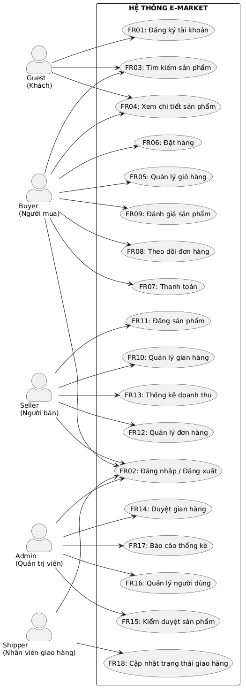
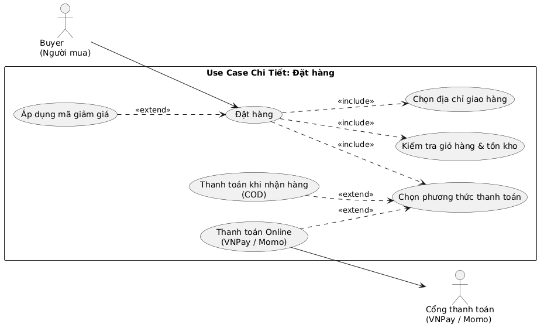
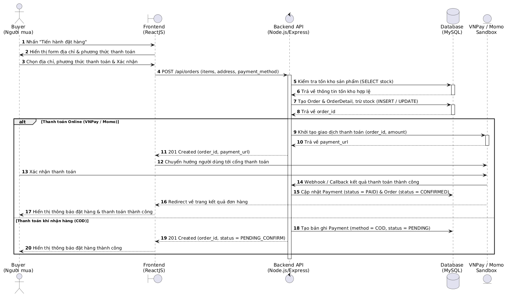
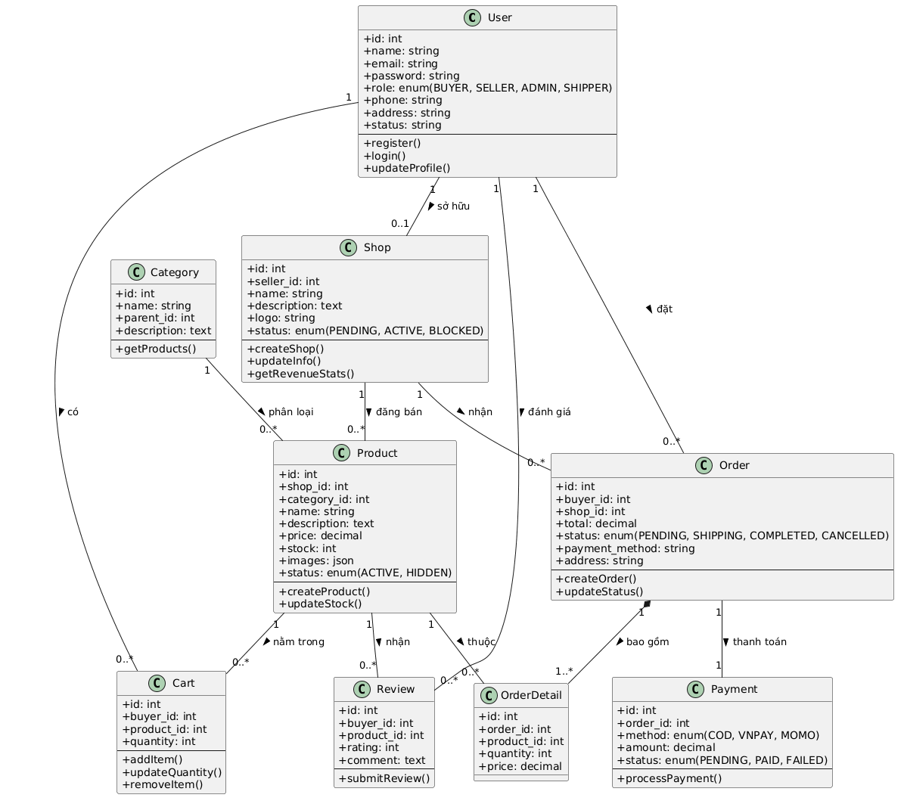

# BÁO CÁO BÀI TẬP MÔN CÔNG NGHỆ PHẦN MỀM
## ĐỀ TÀI: E-MARKET – CHỢ ĐIỆN TỬ TRỰC TUYẾN

---

## PHẦN 1: PD (PRODUCT DESIGN – THIẾT KẾ SẢN PHẨM)

*Mô tả ý tưởng sản phẩm*

### 1.1. Đề xướng ý tưởng sản phẩm: E-Market – Chợ điện tử trực tuyến
- **Định hướng sản phẩm:** E-Market là nền tảng thương mại điện tử đa gian hàng (Multi-vendor), kết nối trực tiếp người mua với các hộ kinh doanh nhỏ và nhà sáng tạo. Sản phẩm giải quyết bài toán chi phí vận hành website cho người bán và mang lại trải nghiệm mua sắm tập trung, minh bạch cho người mua.
- **Đối tượng hướng tới:** Khách hàng cá nhân (mua sắm), Hộ kinh doanh (mở shop), Nhân viên giao hàng (đối tác vận chuyển), Quản trị viên (vận hành sàn).
- **Tính khả thi:** Dự án có độ khó kỹ thuật ở mức Cao (yêu cầu tích hợp thanh toán, quản lý đa gian hàng). Dự kiến thời gian phát triển bản MVP (sản phẩm khả dụng tối thiểu) là 3-4 tháng đối với nhóm 4 người.
- **Cơ sở kiến thức & kỹ năng của nhóm:**
  - **Chuyên môn:** Đã trang bị kiến thức về Phân tích thiết kế hệ thống (UML), Cơ sở dữ liệu quan hệ, và Lập trình Web (React/Node.js).
  - **Kỹ năng:** Làm việc nhóm qua Git, thiết kế UI/UX cơ bản, quản lý tiến độ qua Trello.

---

## PHẦN 2: CRS (CUSTOMER REQUIREMENTS SPECIFICATION – ĐẶC TẢ YÊU CẦU KHÁCH HÀNG)

### 2.1. Người dùng hệ thống (Actor)

| STT | Tên tác nhân | Mô tả |
| :-: | :--- | :--- |
| 1 | Khách (Guest) | Người truy cập chưa đăng nhập, có thể xem sản phẩm, tìm kiếm, xem gian hàng nhưng chưa thể mua hàng. |
| 2 | Người mua (Buyer) | Người dùng đã đăng ký tài khoản, có thể tìm kiếm, thêm giỏ hàng, đặt hàng, thanh toán, theo dõi đơn và đánh giá sản phẩm. |
| 3 | Người bán (Seller) | Chủ gian hàng, có thể đăng sản phẩm, quản lý đơn hàng, theo dõi doanh thu, phản hồi đánh giá của khách. |
| 4 | Quản trị viên (Admin) | Quản lý toàn bộ hệ thống: duyệt gian hàng, quản lý người dùng, kiểm duyệt sản phẩm, xem báo cáo thống kê. |
| 5 | Nhân viên giao hàng (Shipper) | Nhận đơn, cập nhật trạng thái giao hàng, xác nhận giao thành công. |

### 2.2. Yêu cầu chức năng (Functional Requirements)

| Mã | Tên chức năng | Mô tả | Actor |
| :-: | :--- | :--- | :--- |
| FR01 | Đăng ký tài khoản | Người dùng đăng ký với email/số điện thoại, chọn vai trò Buyer/Seller | Guest |
| FR02 | Đăng nhập / Đăng xuất | Xác thực người dùng bằng email/mật khẩu hoặc OTP | Tất cả |
| FR03 | Tìm kiếm sản phẩm | Tìm theo tên, danh mục, khoảng giá, đánh giá, gian hàng | Guest, Buyer |
| FR04 | Xem chi tiết sản phẩm | Xem hình ảnh, mô tả, giá, tồn kho, đánh giá | Guest, Buyer |
| FR05 | Quản lý giỏ hàng | Thêm/xóa/sửa số lượng sản phẩm trong giỏ | Buyer |
| FR06 | Đặt hàng | Chọn địa chỉ, phương thức thanh toán, xác nhận đơn | Buyer |
| FR07 | Thanh toán | Thanh toán COD hoặc online (VNPay, Momo, chuyển khoản) | Buyer |
| FR08 | Theo dõi đơn hàng | Xem trạng thái đơn: chờ xác nhận → đang giao → hoàn thành | Buyer |
| FR09 | Đánh giá sản phẩm | Viết đánh giá, chấm sao sau khi nhận hàng | Buyer |
| FR10 | Quản lý gian hàng | Tạo, chỉnh sửa thông tin gian hàng | Seller |
| FR11 | Đăng sản phẩm | Thêm/sửa/xóa sản phẩm, cập nhật giá, tồn kho, hình ảnh | Seller |
| FR12 | Quản lý đơn hàng | Xem, xác nhận, hủy, cập nhật trạng thái đơn | Seller |
| FR13 | Thống kê doanh thu | Xem doanh thu theo ngày/tuần/tháng, sản phẩm bán chạy | Seller |
| FR14 | Duyệt gian hàng | Phê duyệt/từ chối đăng ký mở gian hàng | Admin |
| FR15 | Kiểm duyệt sản phẩm | Duyệt/ẩn sản phẩm vi phạm chính sách | Admin |
| FR16 | Quản lý người dùng | Khóa/mở khóa tài khoản, phân quyền | Admin |
| FR17 | Báo cáo thống kê | Thống kê doanh thu toàn sàn, số đơn, số người dùng | Admin |
| FR18 | Cập nhật trạng thái giao hàng | Nhận đơn, cập nhật đang giao/đã giao | Shipper |

### 2.3. Yêu cầu phi chức năng (Non-Functional Requirements)

| Mã | Loại | Yêu cầu |
| :-: | :--- | :--- |
| NFR01 | Hiệu năng | Trang chủ tải dưới 3 giây, hỗ trợ tối thiểu 1.000 người truy cập đồng thời |
| NFR02 | Bảo mật | Mật khẩu mã hóa bcrypt, phân quyền rõ ràng, chống SQL Injection/XSS |
| NFR03 | Khả dụng | Hệ thống hoạt động 99,5% thời gian, có backup dữ liệu hằng ngày |
| NFR04 | Tương thích | Responsive trên desktop, tablet, mobile; hỗ trợ Chrome, Firefox, Safari, Edge |
| NFR05 | Khả năng mở rộng | Kiến trúc module hóa, dễ thêm gian hàng chuyên biệt (nông sản, đồ cũ, sản phẩm số) |
| NFR06 | Tính dễ dùng | Giao diện thân thiện, hỗ trợ tiếng Việt, tối đa 3 bước để hoàn tất đặt hàng |
| NFR07 | Sao lưu & phục hồi | Backup tự động hằng ngày, phục hồi trong vòng 24h |

### 2.4. Biểu đồ Use Case tổng quát (Hình ảnh)



---

## PHẦN 3: RA (RISK ANALYSIS – PHÂN TÍCH RỦI RO)

### 3.1. Bảng phân tích rủi ro

| STT | Rủi ro | Loại | Khả năng xảy ra | Mức độ ảnh hưởng | Biện pháp giảm thiểu |
| :-: | :--- | :---: | :---: | :---: | :--- |
| R01 | Thành viên không đủ kỹ năng lập trình backend phức tạp | Kỹ thuật | Cao | Cao | Phân công học tập, chọn framework phổ biến (Laravel/Node.js), có mentor hỗ trợ |
| R02 | Tiến độ trễ do phân chia công việc chưa hợp lý | Nhân sự | Trung bình | Cao | Lập kế hoạch chi tiết theo tuần, họp tiến độ 2 lần/tuần, dùng Trello/Notion |
| R03 | Xung đột trong nhóm về ý tưởng/cách làm | Nhân sự | Trung bình | Trung bình | Bầu nhóm trưởng, quy định quy trình ra quyết định, tôn trọng ý kiến đa số |
| R04 | Dữ liệu mẫu không đủ để demo | Kỹ thuật | Cao | Thấp | Chuẩn bị script seed dữ liệu, dùng dữ liệu giả lập |
| R05 | Rủi ro bảo mật (lộ thông tin người dùng) | Kỹ thuật | Thấp | Cao | Mã hóa mật khẩu, validate input, phân quyền, test bảo mật trước khi nộp |
| R06 | Thanh toán online gặp lỗi tích hợp | Kỹ thuật | Trung bình | Cao | Dùng sandbox VNPay/Momo, có phương án dự phòng COD |
| R07 | Chi phí hosting/domain vượt dự toán | Tài chính | Trung bình | Thấp | Dùng hosting free tier (Render, Vercel), domain sinh viên |
| R08 | Thị trường đã có nhiều sàn lớn (Shopee, Lazada) | Thị trường | Cao | Trung bình | Tập trung ngách: gian hàng chuyên biệt (nông sản, đồ cũ, sản phẩm số) |
| R09 | Mất dữ liệu do lỗi máy tính | Kỹ thuật | Trung bình | Cao | Backup code lên GitHub, backup DB định kỳ |
| R10 | Khó thu hút người bán tham gia ban đầu | Thị trường | Cao | Trung bình | Demo với gian hàng mẫu, mời bạn bè/người quen trải nghiệm |

### 3.2. Ma trận rủi ro

```text
Ảnh hưởng
   Cao  │  R05        R01, R02, R06, R09
        │
   TB   │  R07        R03, R08, R10
        │
  Thấp  │  R04
        └──────────────────────────────
           Thấp    TB    Cao   Khả năng
```

---

## PHẦN 4: TS (TECHNICAL SPECIFICATION – ĐẶC TẢ KỸ THUẬT)

### 4.1. Kiến trúc hệ thống
Hệ thống E-Market sử dụng kiến trúc 3 lớp (3-tier architecture):
- **Presentation Layer (Giao diện):** ReactJS + TailwindCSS/Bootstrap. (Trang Buyer, Seller Dashboard, Admin Dashboard).
- **Business Logic Layer (Xử lý nghiệp vụ):** Node.js + Express (hoặc Laravel). Xử lý đơn hàng, thanh toán, xác thực, tìm kiếm.
- **Data Layer (Dữ liệu):** MySQL/PostgreSQL. Lưu trữ Users, Products, Orders, Shops, Reviews.

### 4.2. Công nghệ sử dụng

| Thành phần | Công nghệ đề xuất |
| :--- | :--- |
| Frontend | ReactJS + TailwindCSS / Bootstrap |
| Backend | Node.js + Express (hoặc Laravel) |
| Database | MySQL 8.0 |
| Authentication | JWT + bcrypt |
| Thanh toán | VNPay Sandbox / Momo Sandbox (dự phòng COD) |
| Lưu trữ ảnh | Cloudinary / Firebase Storage |
| Triển khai | Vercel (FE) + Render (BE) + Railway (DB) |
| Quản lý mã nguồn | GitHub |

### 4.3. Mô hình dữ liệu (ERD – Các thực thể chính)

| Thực thể | Thuộc tính chính | Quan hệ |
| :--- | :--- | :--- |
| User | id, name, email, password, role, phone, address, status | 1-n với Order, 1-1 với Shop |
| Shop | id, seller_id, name, description, logo, status | n-1 với User, 1-n với Product |
| Category | id, name, parent_id, description | 1-n với Product |
| Product | id, shop_id, category_id, name, description, price, stock, images, status | n-1 với Shop, n-1 với Category |
| Cart | id, buyer_id, product_id, quantity | n-1 với User, n-1 với Product |
| Order | id, buyer_id, shop_id, total, status, payment_method, address | n-1 với User, n-1 với Shop |
| OrderDetail | id, order_id, product_id, quantity, price | n-1 với Order, n-1 với Product |
| Payment | id, order_id, method, amount, status | 1-1 với Order |
| Review | id, buyer_id, product_id, rating, comment | n-1 với User, n-1 với Product |

### 4.4. Biểu đồ Use Case chi tiết – "Đặt hàng" (Có include/extend)



### 4.5. Biểu đồ tuần tự (Sequence Diagram) – Use Case "Đặt hàng"



### 4.6. Biểu đồ lớp (Class Diagram) – Các lớp chính



### 4.7. Thiết kế API (Các endpoint chính)

| Method | Endpoint | Mô tả | Quyền |
| :-: | :--- | :--- | :--- |
| POST | `/api/auth/register` | Đăng ký tài khoản | Public |
| POST | `/api/auth/login` | Đăng nhập, trả JWT | Public |
| GET | `/api/products` | Danh sách sản phẩm (filter, search) | Public |
| POST | `/api/cart` | Thêm vào giỏ hàng | Buyer |
| POST | `/api/orders` | Tạo đơn hàng | Buyer |
| GET | `/api/orders/my` | Đơn hàng của tôi | Buyer |
| POST | `/api/shops` | Tạo gian hàng | Seller |
| POST | `/api/products` | Thêm sản phẩm | Seller |
| GET | `/api/seller/revenue` | Thống kê doanh thu | Seller |
| PUT | `/api/admin/shops/:id/approve` | Duyệt gian hàng | Admin |
| PUT | `/api/shipper/orders/:id/status` | Cập nhật giao hàng | Shipper |

